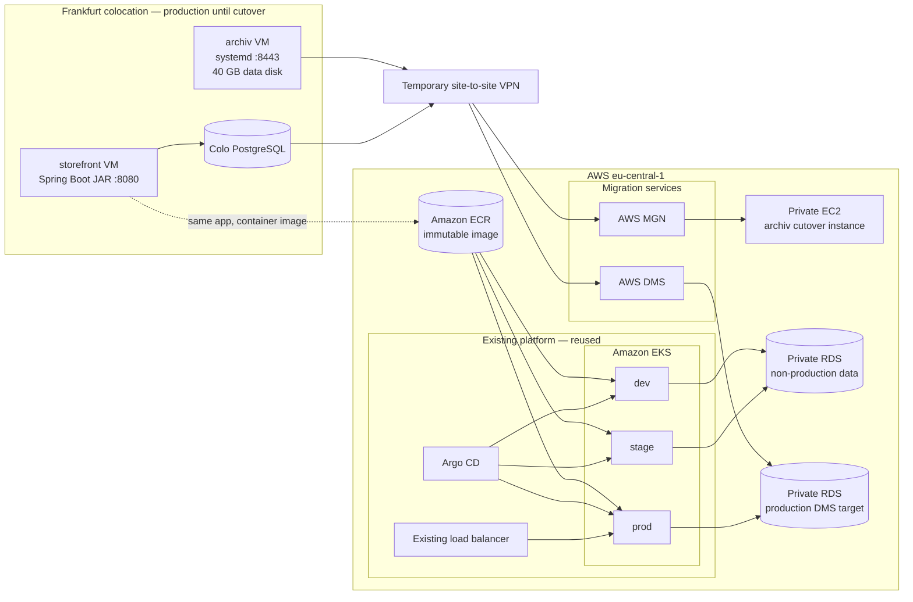

# Feldmarkt migration

**A controlled on-premises-to-AWS migration blueprint.** Rehost the `archiv` virtual machine, replatform the existing Spring Boot `storefront` application onto an existing Amazon EKS GitOps path, and move PostgreSQL to private Amazon RDS.

[Architecture decisions](docs/decisions.md) · [Migration scenario](docs/scenario.md) · [Cutover runbook](docs/cutover.md) · [Implementation guide](docs/implementation.md)

**Status: blueprint only.** The repository contains the plan and implementation shapes for migration waves 1 and 2. Nothing here has been applied to a cloud account. This is not an employer system.

---

## At a glance

| Area | Current state | Target / migration approach |
|---|---|---|
| Source | Two Ubuntu VMs in a Frankfurt colocation site | Temporary site-to-site VPN to the existing AWS VPC |
| `archiv` | systemd service on port `8443`; 40 GB at `/var/lib/feldmarkt`; two users | Rehost with AWS Application Migration Service (MGN) to a private EC2 instance; Systems Manager access; no public SSH |
| `storefront` | Spring Boot 3.5.5 JAR on port `8080`; PostgreSQL on the same VM | Keep the monolith and version; containerize the same application and deploy through the existing EKS GitOps path |
| Database | PostgreSQL on the `storefront` VM | Same-major-version PostgreSQL on private RDS, replicated with AWS DMS |
| Delivery | Shell script copies the JAR to the VM | GitHub Actions builds and publishes an immutable image, then opens a digest-only PR; Argo CD reconciles Git |
| Cutover | Production remains in the colo | Sunday 02:00–06:00 CET, only after workload-specific proof checks |
| Recovery | Colo remains available | Seven days of hypercare with the colo and VPN retained for rollback |

## Architecture

The diagram separates migration services from the destination platform. The VPC, EKS cluster, Argo CD, AWS Load Balancer Controller, and load balancer are existing landing-zone components; this repository does not recreate them.



### Delivery and promotion

1. GitHub Actions builds the `storefront` image, scans it, and pushes it to ECR.
2. The workflow opens a pull request that changes only `gitops/envs/dev` with the immutable image digest.
3. Argo CD pulls the Git change and reconciles dev. Stage and prod digest changes are reviewed Git commits.
4. Production sync is manual during the cutover window, after database proofs and sequence alignment.
5. CI does **not** run `kubectl` or trigger an Argo CD sync.

Dev and stage use RDS containing non-production data. The production DMS target is reserved for production cutover; the environments do not share that database.

## Migration waves

| Wave | Scope | Repository location |
|---|---|---|
| 0 — Define | Scenario, requirements, decisions, architecture, cutover plan | [`docs/`](docs/) |
| 1 — Rehost | Private EC2 landing shape for the MGN-launched `archiv` instance | [`terraform/wave1-archiv/`](terraform/wave1-archiv/) |
| 2 — Replatform | Private RDS, stopped DMS task definition, immutable ECR, application stand-in, Helm chart, GitOps pins, digest PR workflow | [`terraform/wave2-storefront/`](terraform/wave2-storefront/), [`app/storefront/`](app/storefront/), [`charts/storefront/`](charts/storefront/), [`gitops/`](gitops/), [`.github/workflows/`](.github/workflows/) |
| 3 — Decommission | Remove the colo and VPN after seven clean days | Described in the scenario; no automation in this repository |

## Repository map

```text
feldmarkt-migration/
├── ansible/                 # Ansible automation and playbooks
├── app/
│   └── storefront/           # Small application stand-in: /health and SELECT 1
├── charts/
│   └── storefront/           # Digest-pinned Helm chart
├── docs/                     # Scenario, requirements, ADRs, architecture, runbooks
├── gitops/
│   ├── envs/dev/              # Dev image and configuration pins
│   ├── envs/stage/            # Stage image and configuration pins
│   └── envs/prod/             # Prod image and configuration pins
├── terraform/
│   ├── wave1-archiv/          # Private EC2 landing shape for MGN
│   └── wave2-storefront/      # Private RDS, DMS task shape, immutable ECR
└── .github/
    └── workflows/             # Build, publish, and open digest-only PR
```

The application under `app/storefront` is a **pipeline stand-in**, not the Feldmarkt shop. It provides the health contract and a `SELECT 1` database check so the delivery path can be exercised. The real shop remains the existing Spring Boot 3.5.5 monolith; this migration does not rewrite it, split it into microservices, or upgrade Spring Boot.

## Cutover and rollback

The Sunday window is 02:00–06:00 CET. Each workload has an independent go/no-go decision:

- **`archiv`:** final MGN sync, matching data-volume checksum, successful export, and volume snapshot must all be recorded before private DNS changes.
- **`storefront`:** freeze writes, wait for DMS lag zero, compare row counts, align sequences, manually sync prod, and verify `GET /health` returns 200 from pods using production RDS before public DNS changes.
- **No-go:** a failed proof leaves that workload's DNS on the colo. A no-go for one workload does not reverse a go already recorded for the other.
- **Hypercare:** retain the colo machines, colo PostgreSQL, and VPN for seven days. Wave 3 decommissioning is outside the code in this repository.

## Security boundaries and explicit non-goals

- `archiv` runs in a private subnet and is reached through Systems Manager; no public SSH ingress.
- RDS is private. Database access is restricted to the appropriate pod security groups and DMS.
- Secrets are referenced through Secrets Manager and the existing External Secrets integration; credentials are not committed to Git.
- The existing VPC, EKS cluster, Argo CD, load balancer, and observability platform are reused.
- No second database engine, schema rewrite, Spring Boot upgrade, microservice split, new VPC or EKS cluster, second region, or automated colo shutdown is part of this blueprint.

## Suggested reading order

1. [`docs/scenario.md`](docs/scenario.md) — migration story and recovery points
2. [`docs/requirements.md`](docs/requirements.md) — measurable acceptance and proof checks
3. [`docs/decisions.md`](docs/decisions.md) — architecture decision records
4. [`docs/architecture.md`](docs/architecture.md) — current, transition, cutover, and hypercare states
5. [`docs/cutover.md`](docs/cutover.md) — operator checklist and blank evidence fields
6. [`docs/implementation.md`](docs/implementation.md) — tools, prerequisites, and execution order

---

**Key takeaway:** this repository demonstrates a controlled migration from Frankfurt to AWS with explicit workload boundaries, immutable artifact promotion, GitOps reconciliation, private data services, measurable cutover gates, and a seven-day rollback window.
