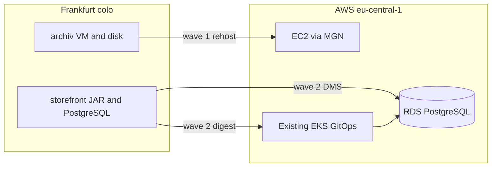
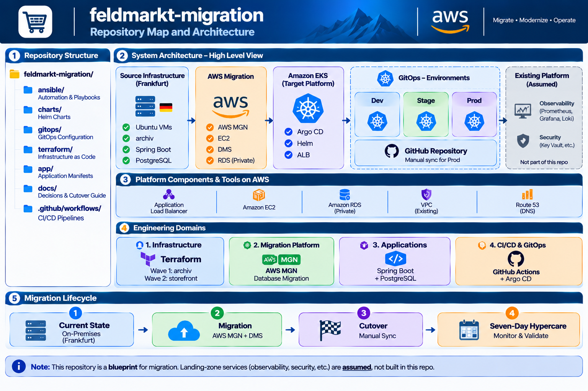

# feldmarkt-migration

On-premises workload migration to AWS: rehost one virtual machine, replatform one Spring Boot monolith and its PostgreSQL database onto an existing EKS GitOps path.

[](https://www.terraform.io/)
[](https://aws.amazon.com/)
[](ansible/README.md)
[](docs/scenario.md)
[](LICENSE)

> Status: Blueprint. Wave 1, wave 2, and Ansible migration runbooks are encoded so they can be applied later. Nothing in this repository has been applied to a cloud account. This is not an employer system.

Destination pattern: [boutique-eks-gitops](https://github.com/btilki/boutique-eks-gitops) · Author: [Birol Tilki](https://www.linkedin.com/in/birol-tilki-48731326/)

---

## Problem

A colo contract ends. Two Ubuntu virtual machines still run production: an internal archive with a data disk, and a Spring Boot shop with PostgreSQL on the same host. Releases are a shell script. The database and the archive stay tied to rented rack space. Rewriting the shop, upgrading Spring Boot, or splitting into microservices in the same weekend as the move adds risk without solving the colo deadline.

## Decision

- Rehost `archiv` with MGN to a private EC2 instance. Systems Manager only. No public SSH ([D1](docs/decisions.md)).
- Replatform the same Spring Boot JAR onto the existing EKS GitOps path. CI opens a digest change. Argo CD deploys. CI never deploys ([D2](docs/decisions.md)).
- Move PostgreSQL to private RDS with DMS. Same major version, same schema ([D4](docs/decisions.md)).
- DNS is the caller switch on Sunday 02:00–06:00 CET, only after proofs. Seven days of hypercare with the colo still on for rollback ([D6](docs/decisions.md)).
- Ansible encodes prep, freeze, proofs, and a check-only validate after MGN cutover. It is not day-2 estate management ([D8](docs/decisions.md)).

## Result

The blueprint holds scenario, requirements, decisions, architecture, a blank cutover note, wave 1 and wave 2 Terraform, the storefront chart and GitOps pins, a stand-in image, and Ansible runbooks. Local proofs that exist today: `terraform validate`, `mvn verify`, `helm template`, `ansible-lint`. No lived cutover, no billable AWS resources from this repository.

---

## At a glance

| | |
|-|-|
| What | Colo → AWS `eu-central-1`: MGN rehost, DMS to RDS, digest GitOps onto existing EKS |
| Hard rule | CI never deploys — GitHub Actions opens a digest PR for dev; Argo CD reconciles; prod sync is manual |
| Scope | Blueprint for two workloads and one Sunday window — not a lived pilot |
| Stack | Terraform · MGN · DMS · RDS · EKS · Argo CD · Helm · Ansible · GitHub Actions |

---

## Proof

This repository is a blueprint. There is no live cutover screenshot set.

What has been checked locally while encoding the design:

- Terraform validate for wave 1 and wave 2 (AWS provider 6.x)
- `mvn verify` on the storefront stand-in (Spring Boot 3.5.5)
- `helm template` for digests and prod Ingress
- `ansible-playbook --syntax-check` and `ansible-lint` on `ansible/`

Operator evidence for a real window still lives as blank lines in [docs/cutover.md](docs/cutover.md).

---

## Tradeoffs / what I would change for a lived run

- Blueprint, not applied — inventory hostnames, exact Spring/Postgres minors, and colo DNS provider steps stay placeholders until a real window.
- The app under `app/storefront/` is a stand-in (`GET /health` + `SELECT 1`), not the Feldmarkt shop JAR.
- Site-to-site VPN is described and required; this repo has no Terraform for it.
- Wave 3 (remove colo and VPN) is prose only.
- VPC, EKS, Argo CD, and the ALB group are assumed from the existing landing zone ([boutique-eks-gitops](https://github.com/btilki/boutique-eks-gitops) pattern).
More detail: [docs/lessons-learned.md](docs/lessons-learned.md) · [ROADMAP.md](ROADMAP.md)

---

## Where to start

| I want to… | Read |
|------------|------|
| Understand the project in ~10 minutes | This page → [docs/scenario.md](docs/scenario.md) → [docs/decisions.md](docs/decisions.md) |
| See the Sunday order | [docs/cutover.md](docs/cutover.md) · [docs/architecture.md](docs/architecture.md) |
| Apply later (operator path) | [docs/implementation.md](docs/implementation.md) · [ansible/README.md](ansible/README.md) |
| Read the yes-or-no checks | [docs/requirements.md](docs/requirements.md) |
| Browse the full docs list | [docs/README.md](docs/README.md) |

---

## Migration flow (summary)



Before Sunday, production DNS and writes stay on the colo. Dev and stage rehearse against nonprod RDS. On Sunday, writes freeze, copies finish, proofs pass, then DNS moves. Hypercare is seven days with the colo still powered for rollback.

---

## Repository map and navigation

Use this map for the migration flow, platform components, and where each engineering area lives.



---

## The two workloads

| Workload | Today | This wave |
|----------|--------|-----------|
| `archiv` | systemd on port 8443, 40 GB disk at `/var/lib/feldmarkt`, two users | MGN cutover instance in a private subnet. Systems Manager. No public SSH. |
| `storefront` | One Spring Boot JAR on port 8080. Shell-script deploy. PostgreSQL on the same machine. | Container on the existing EKS path. Database on RDS. Spring Boot version unchanged. |

A rewrite, a Spring Boot upgrade, and a split into microservices are refused for this wave. Reasons: [docs/decisions.md](docs/decisions.md).

## Waves

| Wave | What moves | Where it lives |
|------|------------|----------------|
| 0 | Scenario, requirements, decisions, architecture, cutover note | [docs/](docs/) |
| 1 | `archiv` landing shape. MGN launches the machine. | [terraform/wave1-archiv](terraform/wave1-archiv/) |
| 2 | Chart, digest pins, CI that does not deploy, private RDS, stopped DMS task | [charts/storefront](charts/storefront/), [gitops/](gitops/), [terraform/wave2-storefront](terraform/wave2-storefront/) |
| — | Migration runbooks (prep, freeze, proofs, validate) | [ansible/](ansible/) |
| 3 | Colo and VPN removed after seven clean days | Written in the scenario. No code. |

---

## Technology stack

| Area | Choices |
|------|---------|
| Cloud / region | AWS `eu-central-1` |
| IaC | Terraform >= 1.9, AWS provider ~> 6.0 |
| Rehost | MGN → private EC2, Systems Manager |
| Database | DMS → private RDS PostgreSQL (same major, same schema) |
| App delivery | Helm, digest pins, Argo CD; GitHub Actions digest PR for dev only |
| Migration automation | Ansible runbooks (not day-2 estate management) |
| Secrets | Secrets Manager + External Secrets (ClusterSecretStore `aws-secrets`) |

---

## Repository layout

```text
feldmarkt-migration/
├── docs/                      # Scenario, requirements, decisions, cutover, implementation
├── ansible/                   # Migration runbooks (prep, freeze, proofs, validate)
├── terraform/wave1-archiv/    # Private EC2 landing shape for MGN
├── terraform/wave2-storefront/# Private RDS, DMS task created stopped, ECR
├── app/storefront/            # Stand-in image: GET /health and SELECT 1
├── charts/storefront/         # Digest-pinned Helm chart
├── gitops/                    # Dev, stage, prod pins; prod sync is manual
├── assets/images/             # Architecture map
└── .github/workflows/         # Digest PR (dev) · ansible-lint
```

The stand-in is not the Feldmarkt shop. Spring Boot 3.5.5 is the version this blueprint moves, not an upgrade target.

---

## Outside this repository

A second database, a different engine, a schema rewrite, a new VPC or EKS cluster, a new progressive-delivery or observability stack, VMware tooling, Ansible as day-2 estate management, a second region, and code that turns the colo off.

The VPC, the cluster, and Argo CD are the existing landing zone. This repository does not build them again.

---

## Quick clone

```bash
git clone https://github.com/btilki/feldmarkt-migration.git
cd feldmarkt-migration
```

Do not apply Terraform or run freeze playbooks from this file. Operator order: [docs/implementation.md](docs/implementation.md).

---

## Contributing · License · References

- Contributing: [CONTRIBUTING.md](CONTRIBUTING.md)
- Security: [SECURITY.md](SECURITY.md)
- Changelog: [CHANGELOG.md](CHANGELOG.md)
- Roadmap: [ROADMAP.md](ROADMAP.md)

Licensed under Apache License 2.0 — see [LICENSE](LICENSE).

Stack references: [AWS MGN](https://docs.aws.amazon.com/mgn/) · [AWS DMS](https://docs.aws.amazon.com/dms/) · [Argo CD](https://argo-cd.readthedocs.io/) · [Ansible](https://docs.ansible.com/) · [External Secrets](https://external-secrets.io/)
