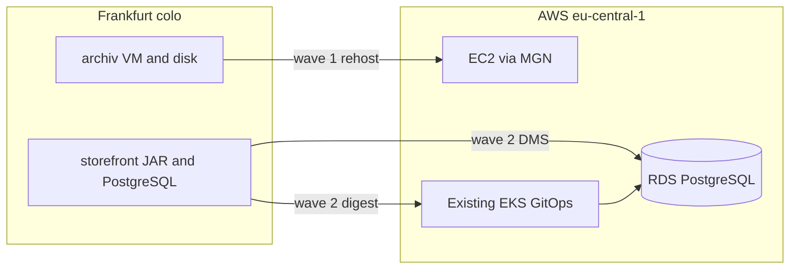

# Feldmarkt migration

On-premises workload migration to **AWS** (**Amazon Web Services**): rehost one virtual machine, replatform one Spring Boot monolith and its PostgreSQL database onto an existing **EKS** (**Elastic Kubernetes Service**) **GitOps** (**Git operations**) path.

Destination pattern: [boutique-eks-gitops](https://github.com/btilki/boutique-eks-gitops) · Author: [Birol Tilki](https://www.linkedin.com/in/birol-tilki-48731326/)

**Status:** blueprint. Wave 1 and wave 2 are encoded so they can be applied later. Nothing in this repository has been applied to a cloud account. This is not an employer system.

### At a glance

| | |
|-|-|
| **Source** | Two Ubuntu virtual machines in a Frankfurt colocation site |
| **`archiv`** | Rehost to **EC2** (**Elastic Compute Cloud**) with **MGN** (**AWS Application Migration Service**) |
| **`storefront`** | Replatform the same Spring Boot **JAR** (**Java Archive**) to EKS. **CI** (**Continuous Integration**) opens a digest change. **Argo CD** (**Continuous Delivery**) deploys. |
| **Database** | Replatform PostgreSQL to private **RDS** (**Amazon Relational Database Service**) with **DMS** (**AWS Database Migration Service**). Same major version, same schema. |
| **Switch** | **DNS** (**Domain Name System**), Sunday 02:00–06:00 **CET** (**Central European Time**), only after the proofs pass |
| **After cutover** | Seven days of hypercare. The colo stays on for rollback. |
| **Start reading** | [Scenario](docs/scenario.md) → [Decisions](docs/decisions.md) → [Cutover](docs/cutover.md) |



## The two workloads

| Workload | Today | This wave |
|----------|--------|-----------|
| `archiv` | systemd on port 8443, 40 GB disk at `/var/lib/feldmarkt`, two users | MGN cutover instance in a private subnet. Systems Manager. No public **SSH** (**Secure Shell**). |
| `storefront` | One Spring Boot JAR on port 8080. A shell script copies the JAR. PostgreSQL on the same machine. | Container on the existing EKS path. Database on RDS. Spring Boot version unchanged. |

A rewrite, a Spring Boot upgrade, and a split into microservices are refused for this wave. The reasons are in [docs/decisions.md](docs/decisions.md).

## Waves

| Wave | What moves | Where it lives |
|------|------------|----------------|
| 0 | Nothing. Scenario, requirements, decisions, architecture, cutover note. | [docs/](docs/) |
| 1 | `archiv` landing shape. MGN launches the machine. | [terraform/wave1-archiv](terraform/wave1-archiv/) |
| 2 | `storefront` chart, digest pins, CI that does not deploy, private RDS and a stopped DMS task. | [charts/storefront](charts/storefront/), [gitops/](gitops/), [terraform/wave2-storefront](terraform/wave2-storefront/) |
| 3 | Colo and **VPN** (**Virtual Private Network**) removed after seven clean days. | Written in the scenario. No code. |

Before Sunday, production DNS and production writes stay on the colo. Dev and stage rehearse against RDS that is not the DMS target. On Sunday, writes freeze, the copies finish, and DNS changes only after the checks. For the next seven days the new path is live and the colo stays powered on so DNS can point back.

## Read this order

1. [docs/scenario.md](docs/scenario.md) — the story and the recovery points
2. [docs/requirements.md](docs/requirements.md) — the yes-or-no checks
3. [docs/decisions.md](docs/decisions.md) — why each path won
4. [docs/architecture.md](docs/architecture.md) — colo, during the move, after seven days
5. [docs/cutover.md](docs/cutover.md) — the Sunday template. The lines are blank because this cutover has not been run.
6. [docs/implementation.md](docs/implementation.md) — tool list and the operator order. Nothing in it has been applied.

## Repository

```text
docs/                         wave 0
terraform/wave1-archiv/       private EC2 landing shape for MGN
terraform/wave2-storefront/   private RDS, DMS task created stopped, immutable **ECR** (**Elastic Container Registry**)
app/storefront/               image stand-in: GET /health and SELECT 1
charts/storefront/            digest-pinned Helm chart
gitops/                       dev, stage, and prod pins; prod Argo CD sync is manual
.github/workflows/            digest pull request for dev only
```

The stand-in is not the Feldmarkt shop. The shop is the JAR already running in the colo. The stand-in exists so the pipeline has an image with the same health contract. Spring Boot **3.5.5** is the version this blueprint moves. It is not an upgrade target.

CI updates only `gitops/envs/dev`. It does not run `kubectl` or an Argo CD sync. Stage and prod digests change by a reviewed Git commit. On Sunday the prod Application is synced after the row check and the sequence alignment. `GET /health` is taken from those pods. Public DNS moves only after that 200.

## Outside this repository

A second database, a different database engine, a schema rewrite, a new **VPC** (**Virtual Private Cloud**) or EKS cluster, a new progressive-delivery or observability stack, VMware tooling, Ansible for the estate, a second region, and code that turns the colo off.

The VPC, the cluster, and Argo CD are the existing landing zone. This repository does not build them again.
