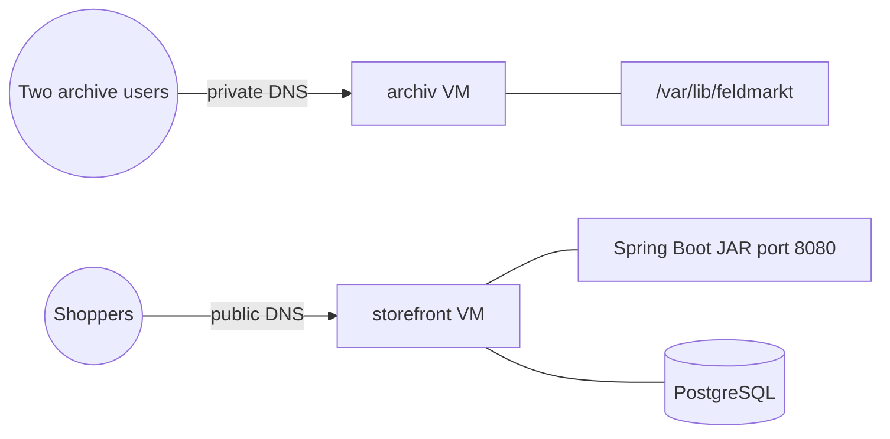
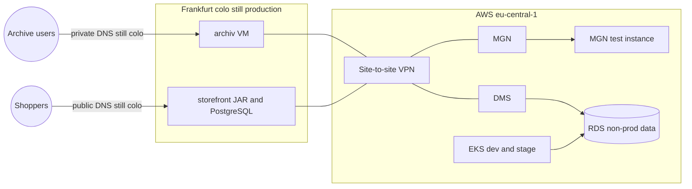
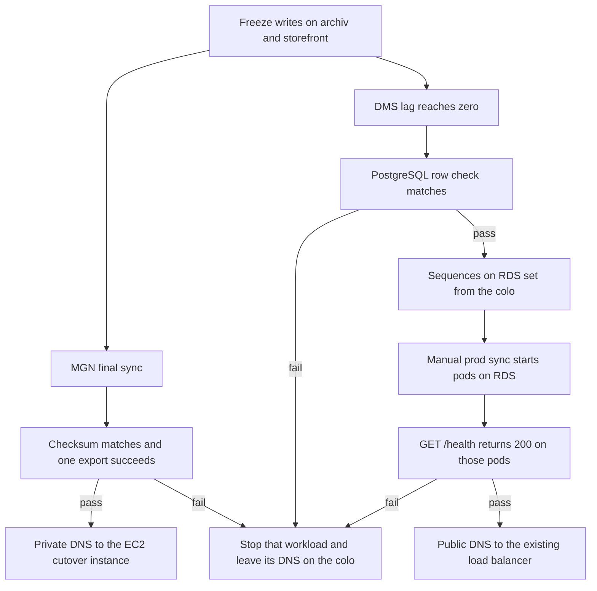
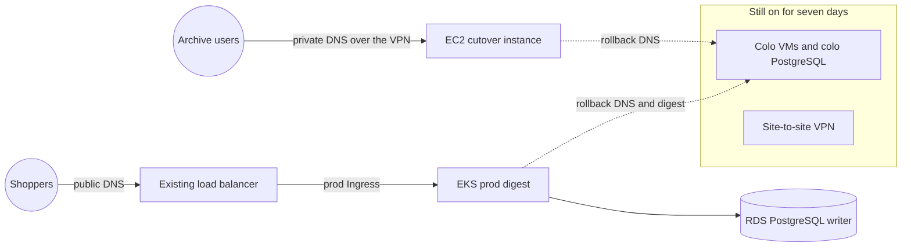

# Feldmarkt migration architecture

**Status:** blueprint. Three pictures of the move in [`scenario.md`](scenario.md), locked by [`decisions.md`](decisions.md). Nothing here has been applied to a cloud account. This is not an employer system.

The **VPC** (**Virtual Private Cloud**), the **EKS** (**Elastic Kubernetes Service**) cluster, and the **Argo CD** (**Continuous Delivery**) path already exist. This architecture does not build them again (D2). It shows how `archiv` and `storefront` join them.

| Box | Owner in this blueprint |
|-----|-------------------------|
| Frankfurt colo, both virtual machines | Source. Stays on through hypercare. |
| Site-to-site **VPN** (**Virtual Private Network**) | Temporary path for **MGN** (**AWS Application Migration Service**) and **DMS** (**AWS Database Migration Service**) (D5). |
| MGN, **EC2** (**Elastic Compute Cloud**) cutover instance, private **DNS** (**Domain Name System**) for `archiv` | Wave 1. |
| DMS, private **RDS** (**Amazon Relational Database Service**), `storefront` image, digest pin, **CI** (**Continuous Integration**) shape | Wave 2. |
| EKS, Argo CD, load balancer | Existing platform. Used, not created here. |
| Colo power-off and VPN removal | Wave 3. Described only. No code. |

## 1. Today, in the colo

Callers never touch **AWS** (**Amazon Web Services**). Two Ubuntu virtual machines sit in the rented Frankfurt rack.

| Piece | How it runs |
|-------|-------------|
| `archiv` | systemd on port 8443. Shop data is the 40 GB disk. |
| `storefront` | systemd runs one Spring Boot **JAR** (**Java Archive**). A shell script copies each new JAR onto the machine. |
| PostgreSQL | On the `storefront` virtual machine. Same major version that RDS will run. The JAR is the only application that writes it. |
| DNS | Private record points at `archiv`. Public record points at `storefront`. |

## 2. During the move

The colo is still production. AWS holds a copy and a rehearsal.

| Path | What moves across the VPN | What callers still use |
|------|---------------------------|------------------------|
| `archiv` | MGN agent replicates the machine. A test instance has already booted and served port 8443 (PRF-3). The cutover instance is not in DNS yet. | Private DNS still names the colo machine. |
| `storefront` | CI has published an image and opened digest changes. Argo CD has deployed dev and stage. Those environments read and write RDS that holds non-production data. | Public DNS still names the colo virtual machine. Production writes still go to colo PostgreSQL. |
| Database | DMS continuously replicates colo PostgreSQL into the private RDS instance that production will use. That task is running before Sunday (TGT-7). | Production writer is still the colo database. |

The archive test instance and the production RDS instance sit in private subnets. Operators reach the archive instance with Systems Manager. RDS has no public endpoint. The Spring Boot version in the image is the version on the colo machine (D3).

Dev and stage must not point at the RDS instance that is receiving the production DMS copy. They use RDS with non-production data so a rehearsal cannot write the shop's production rows.

## 3. Sunday window

Writes freeze on both workloads at 02:00 **CET** (**Central European Time**). The pictures above stay in place until the proofs pass. This is the order inside the window (D6).

Private DNS for `archiv` waits for the disk proofs. For `storefront`, lag zero and the row check come first. Sequences are aligned, then the prod Application is synced, then `GET /health` is taken from those pods. Public DNS moves only after that 200. The database writer switches before shoppers are sent to EKS.

A snapshot of the `archiv` data volume exists before its DNS change (CUT-6).

## 4. After a clean seven days

Hypercare. Production has moved. The colo and the VPN are still there for rollback.

| Caller | Production target | Rollback |
|--------|-------------------|----------|
| Archive users | EC2 in a private subnet, port 8443, over the VPN while it is up | 30 minutes. Private DNS back to the colo machine. Cutover instance stopped and kept. |
| Shoppers | Existing load balancer, through the prod Ingress, to the EKS pods | 15 minutes. Stop the prod pods, stop the DMS task, point DNS back at the colo **VM** (**virtual machine**), revert the Git digest pin. |
| Shop data | RDS is the writer | Application pointed back at colo PostgreSQL. Only rows from the write freeze are recovered. Rows written to RDS after the switch are not copied back (D6). |

Wave 3, after those seven days, removes the VPN and the colo machines. The two archive users then reach port 8443 by Systems Manager port forwarding. The instance stays private. That picture has no code in this repository. The instance profile from wave 1 is what makes the forwarding possible.

## What the later code has to match

Wave 1 code is the private EC2 landing shape for the MGN cutover instance: subnet with no public address, Systems Manager, no inbound **SSH** (**Secure Shell**) from the internet, and the snapshot timing before DNS.

Wave 2 code is the `storefront` chart, the digest pin for dev, stage, and prod, the CI shape that opens a digest change and does not deploy, and the private RDS plus DMS replication shape. The production pin points at the DMS target only for the Sunday cutover. Dev and stage point at the non-production RDS data.
