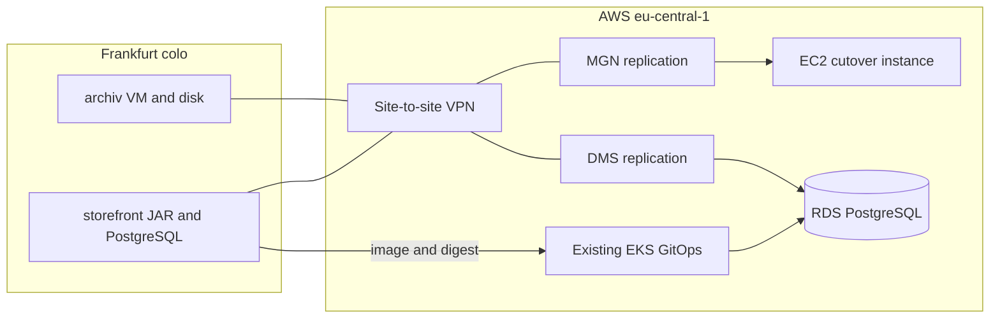

# Feldmarkt migration scenario

**Status:** blueprint. This repository plans the move and encodes wave 1 and wave 2 so they can be applied later. Nothing here has been applied to a cloud account. This is not an employer system.

Feldmarkt is a small retailer. Two Linux virtual machines run in a rented rack in a Frankfurt colocation site. The colo provider owns the building, power, cooling, and network. Feldmarkt owns the machines. The colo contract is ending. The platform team will move these two workloads to **AWS** (**Amazon Web Services**) in `eu-central-1` without rewriting the applications and without changing the Spring Boot version.

The destination platform already exists as a pattern: a **VPC** (**Virtual Private Cloud**) landing zone and an **EKS** (**Elastic Kubernetes Service**) **GitOps** (**Git operations**) path where **CI** (**Continuous Integration**) publishes an image and opens a digest change, and **Argo CD** (**Continuous Delivery**) deploys. This repository does not build that platform again.

## The two workloads

| Name | Today | Path | Why this path |
|------|--------|------|----------------|
| `archiv` | Ubuntu **VM** (**virtual machine**). Internal archive for two people. systemd service on port 8443. 40 GB data disk at `/var/lib/feldmarkt`. | **Rehost** to **EC2** (**Elastic Compute Cloud**) with **MGN** (**AWS Application Migration Service**) | The value is the disk and the installed service. Containerizing it would be a rewrite. |
| `storefront` | Ubuntu VM. One Spring Boot monolith: pages and **API** (**application programming interface**) in a single **JAR** (**Java Archive**), systemd on port 8080. A shell script copies each new JAR onto the machine. PostgreSQL on that same VM holds the shop data. | **Replatform** the JAR to the existing EKS GitOps path. **Replatform** PostgreSQL to **RDS** (**Amazon Relational Database Service**) with **DMS** (**AWS Database Migration Service**) | The JAR has no local shop data. The pain is the release path and a database that still runs on the virtual machine. The application stays the same monolith, on the same Spring Boot version, with the same schema. |

A rewrite, a split into microservices, a Spring Boot upgrade, a **SaaS** (**Software as a Service**) replacement, leaving a workload in the colo, or turning a workload off is the wrong call for this wave. Those options stay recorded here so the choice is visible. The decision records will explain them one by one.

## Two pictures

**During the move.** A site-to-site **VPN** (**Virtual Private Network**) connects the Frankfurt colo to the VPC. The MGN agent on `archiv` replicates that machine over the VPN. DMS replicates `storefront` PostgreSQL over the same VPN into a private RDS instance. The Spring Boot image is promoted through dev and stage against RDS that holds non-production data. Production **DNS** (**Domain Name System**) and production writes still use the colo. Operators reach the archive instance with Systems Manager. That instance has no inbound **SSH** (**Secure Shell**) from the internet. RDS has no public endpoint.

**After a clean seven days.** Private DNS for `archiv` points at the EC2 instance, and the two users reach it over the site-to-site VPN. Public DNS for `storefront` points at the existing load balancer, and the prod Ingress on that load balancer sends shoppers to the pods. That production process writes to RDS. A later change removes the VPN and the colo machines. After that change the two users reach port 8443 by Systems Manager port forwarding. The instance stays private. That later change is wave 3. It is described here and has no code in this repository.

## The window

Sunday 02:00–06:00 **CET** (**Central European Time**).

Before that night, DNS **TTL** (**Time to Live**) is lowered, `archiv` has a tested MGN instance, DMS replication is already running, and `storefront` is already healthy in dev and stage.

At the start of the window, writes freeze on `archiv` and on `storefront`. MGN finishes a final sync. DMS lag reaches zero. The archive checksum must match and one archive export must succeed. The PostgreSQL row check must pass, and sequences on RDS must be set from the colo. The prod Application is synced after that, and `GET /health` must return 200 from those pods. DNS changes only after the checks for that workload pass. A failed check stops that workload and leaves its DNS on the colo.

| Workload | Recovery point | Recovery time | Rollback |
|----------|----------------|---------------|----------|
| `archiv` | The write freeze. Data written before the freeze is on the cutover instance. | 30 minutes. Point private DNS back at the colo machine. | Colo VM still on. New EC2 instance stopped and kept. Volume snapshotted before DNS moves. |
| `storefront` application | The process stores no shop data on local disk. | 15 minutes. Point DNS back at the colo VM and revert the Git digest pin. | Colo VM still on. |
| `storefront` database | The write freeze. Rows written before the freeze are on RDS. | Point the application back at colo PostgreSQL. | Writes that landed on RDS after the switch are not copied back to the colo. |

The colo machines, colo PostgreSQL, and the VPN stay for seven days after a successful DNS change. Those seven days are the hypercare window. During those seven days RDS is the production writer.

## Waves

| Wave | What moves | Result |
|------|------------|--------|
| 0 | Nothing in the data center | This blueprint: scenario, requirements, decisions, architecture, cutover note |
| 1 | `archiv` | MGN replication, private EC2 networking, Systems Manager access, snapshot before DNS |
| 2 | `storefront` | Helm chart, digest pin, CI shape that opens a digest change and does not deploy, DMS replication into private RDS |
| 3 | Colo and VPN | Written in the plan only. No code in this repository |

Each wave finishes, and can be undone, before the next wave starts.

## Frozen outside this repository

- A second database, a different database engine, or a schema rewrite. This move is the existing PostgreSQL schema into RDS, on the same major version.
- A Spring Boot upgrade or a split of the monolith into microservices.
- VMware or other hypervisor tooling. The source is two Linux virtual machines.
- A new VPC, a new EKS cluster, a new progressive-delivery stack, or a new observability stack.
- Ansible for the estate. MGN replicates `archiv` as it is.
- A second region.
- Code that turns off the colo.

If a later idea is not in this scenario, it does not get added after the blueprint is written.
